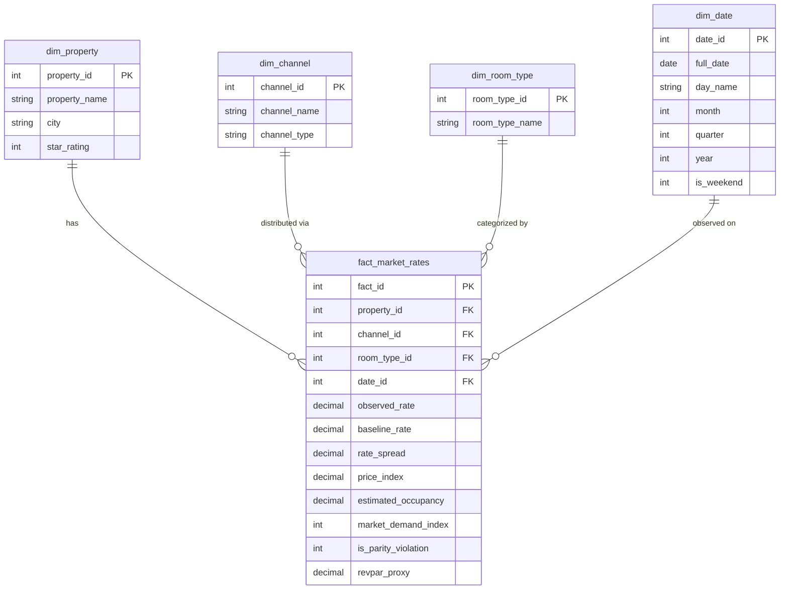

# Technical Architecture & Dimensional Design

## 1. Domain & Business Problem

In hospitality and travel revenue management (e.g., hotel chains, OTAs, revenue management startups like ZettaRMS), pricing decisions rely on continuous competitive intelligence. Hotels distribute inventory across multiple third-party Online Travel Agencies (OTAs)—such as Booking.com, Expedia, and Agoda—as well as their own Direct Brand Websites.

Key operational challenges addressed by this pipeline:
- **Rate Parity Violations:** OTAs frequently undercut direct brand rates by sacrificing margins, leading to direct channel leakage and high commission costs.
- **Dynamic Pricing Elasticity:** Competitor rate fluctuations dictate dynamic surge multipliers during peak demand windows.
- **Heterogeneous Scraping Ingestion:** Rate feeds from web scrapers and external APIs arrive with irregular currencies, formatting noise, sold-out indicators, and duplicate entries.

---

## 2. Dimensional Data Modeling (Star Schema)

The analytical data warehouse is modeled using a classic Kimball Star Schema, separating quantitative metrics into a central Fact Table linked to surrounding dimension tables with strict referential integrity.

---

## 3. Revenue Management Formulas & Metrics

| Metric | Formula | Purpose |
| :--- | :--- | :--- |
| **ADR (Average Daily Rate)** | $\text{ADR} = \frac{\sum \text{Room Revenue}}{\sum \text{Rooms Sold}}$ | Average price achieved per occupied room. |
| **RevPAR (Revenue Per Available Room)** | $\text{RevPAR} = \text{ADR} \times \text{Occupancy Rate}$ | Core health metric measuring pricing and occupancy efficiency combined. |
| **Rate Spread** | $\text{Spread} = \text{Observed Rate} - \text{Baseline Rate}$ | Absolute price differential against the property's direct rate. |
| **Price Index (CPI)** | $\text{CPI} = \left(\frac{\text{Observed Rate}}{\text{Baseline Rate}}\right) \times 100$ | Measures relative market price competitiveness ($>100$ = premium, $<100$ = discount). |
| **Parity Violation** | $\text{If OTA Rate} < \text{Direct Rate} \times 0.98 \implies 1 \text{ else } 0$ | Flags contractual rate leakage across third-party distributors. |

---

## 4. Pipeline Execution Lifecycle

1. **Serialization Benchmark:** Compares read and write performance across CSV, JSON, and Apache Parquet.
2. **Cleansing & Validation:** Strips currency symbols, handles missing values with median imputation, eliminates duplicates, and enforces data quality constraints.
3. **Star Schema Ingestion:** Populates normalized dimension tables with deduplication and caches lookup maps in memory for fast bulk insertion into the fact table.
4. **API Ingestion:** Ingests live foreign exchange benchmarks from a RESTful API and updates regional demand factors.
5. **Analytics & BI Serving:** Executes pre-compiled analytical SQL queries and generates a denormalized flat file ready for Power BI / Tableau consumption.
